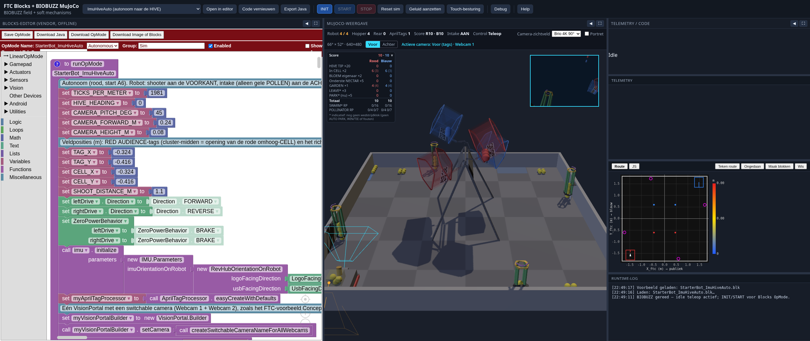

# FTC BIOBUZZ 2026–2027 — MuJoCo simulator

Complete MuJoCo simulation of the FIRST Tech Challenge season **BIOBUZZ** (2026–2027):
field (12×12 ft), official Field CAD meshes (HIVE + FLOWERS), AprilTags on HIVE CELLS,
40 POLLEN, tank-drive robot with **front intake + arc shooter**, HIVE tipping, gamepad/keyboard teleop,
and a REV Blocks-style autonomous layer.



## Installation

```bash
cd /workspace/ftc-biobuzz-mujoco
python3 -m venv .venv
source .venv/bin/activate
pip install -r requirements.txt
pip install -e .
```

## Getting started

```bash
source .venv/bin/activate
export MUJOCO_GL=glfw   # interactive on this box; headless smoke: same, or egl/osmesa

# View the scene only
python -m ftc_sim.viewer

# Teleop (gamepad or keyboard)
python -m ftc_sim.teleop

# Sample autonomous OpMode
python -m ftc_sim.auto

# Headless smoke tests
python -m ftc_sim.viewer --headless
python -m ftc_sim.teleop --headless --seconds=2
python -m ftc_sim.auto --headless
```

## Browser (MuJoCo WASM)

Interactive web app with the same scene, physics in official `@mujoco/mujoco` WASM,
Three.js rendering, keyboard/gamepad teleop + an Autonomous button.

```bash
cd /workspace/ftc-biobuzz-mujoco/web
npm install
npm run dev -- --host 0.0.0.0 --port 5173
# Open http://localhost:5173/  ·  smoke: npm run smoke
```

Details: [`web/README.md`](web/README.md). The Python sim is unchanged.


## Browser: FTC Blocks + BIOBUZZ (combined)

Combined **FTC Offline Blocks** editor + BIOBUZZ MuJoCo field lives in [`web-blocks/`](web-blocks/).

```bash
cd web-blocks
npm install
npm run dev
# http://localhost:5174/
```

GitHub Pages (built from `web-blocks/` via Actions):  
**https://koenvanwijk.github.io/ftc-biobuzz-mujoco/**

The teleop-only WASM app in [`web/`](web/) is unchanged (port 5173).

### Game rules (Competition Manual TU03)

- **HIVE tips** at **8 POLLEN** or **3 NECTAR + 3 POLLEN** in the up CELL (Event Field Setup Guide §12.3) — in `web-blocks/`, `web/` and `ftc_sim/`.
- **G407** (max 4 elements per robot, front + rear combined; start = 4 preload POLLEN, G304.G) and the **score** per alliance according to §10.5 / Table 10-2 / 10-3 (no match clock; LEAVE/PARK/SWARM are indicative, no penalties) live only in `web-blocks/` — see [`web-blocks/README.md`](web-blocks/README.md#game-rules--scoring-competition-manual-tu03). The Python sim and `web/` keep the old hopper (8 + 4) and only count TIPs.


## Controls (teleop)

| Input | Action |
|-------|--------|
| Left stick Y / `W` `S` | Left track |
| Right stick Y / `I` `K` | Right track |
| Arcade: `WASD` / arrow keys | Throttle + turn |
| **Right bumper / `E`** | **Intake toggle** (on by default) |
| **Left bumper / `C`** | FIFO out of the rear compartment (held) |
| **Right trigger / `SPACE` or `F`** | **Shoot one pollen** (impulse, front hopper) |
| **`X` / gamepad X** | FIFO rear → flower stack (nectar or pollen); otherwise drop on the field |
| **`G` / “Bloemen vullen” button** | End-game: put pollen back into flowers (planted stack stays) |
| `T` | Toggle tank ↔ arcade |
| `R` | Reset to start pose (+ 4 preload in the hopper) |
| `Esc` / `Q` | Stop |

### Intake + arc shoot + rear compartment / flowers

- **Front intake** (+X): POLLEN → front hopper (shooter), max 8; **4 preload** start there. (In `web-blocks/`: max 4 elements combined, G407.)
- **Rear intake** (-X): NECTAR and POLLEN → rear compartment (mixed FIFO), max 4.
- **Shooter**: `SPACE`/`F` launches one pollen from the front hopper (`SHOOT_SPEED` 5.7 m/s, elevation 75°).
- **X**: FIFO from the rear compartment into the nearest flower if you are within
  `FLOWER_PLACE_RANGE` (0.55 m) — nectar and pollen stack on the flower center
  (no hard cap of 2; soft cap 8). Too far away → the ball drops on the field behind the robot.
- **C / LB**: FIFO eject from the rear compartment.
- **G / Bloemen vullen**: refills each flower to 4 free pollen (above the planted stack); planted stays.

Blocks helpers in auto:

```python
self.intake.set_power(1.0)   # or 0.0
self.sleep(500)
self.intake.set_power(0.0)
self.shooter.fire()          # or self.shooter.set_power(1.0) → one pulse
```

## CAD source & meshes

| Source | Path / link |
|------|------------|
| Official Field CAD STEP (v26-27.2) | `cad/field-cad-step.zip` → `cad/step/field-cad-step.step` |
| Onshape (reference) | https://cad.onshape.com/documents/a355e772e3d24813de7852ee/w/f106353168f1f92100b81259/e/95d1e1e442b4138cccaf2d73 |
| AprilTag production PDF | `cad/BIOBUZZAprilTagProduction.pdf` |
| Printable A4 | `cad/PrintableAprilTag_A4.pdf` |

**Imported from CAD (STL, meters, Z-up, field center = origin):**

- `hive_frame.stl` — A-frame / feet / ACM panel
- `hive_red.stl` / `hive_blue.stl` — cell skins, churros, pivot (without dense Goal Ribs)
- `flower_{pos_y,neg_y,neg_x,pos_x}.stl` — four FLOWER assemblies at official CAD positions

**Primitives (not from CAD):** floor/tiles, perimeter walls, garden/loading tape, collision boxes
for CELL openings, robot chassis. Perimeter panels/tiles from the STEP were deliberately omitted
(too heavy; the floor stays a simple checker).

Conversion: `cascadio` (STEP→GLB) + `trimesh` + `pyfqmr` (decimate). Units in the STEP are **meters**
(SI). Onshape Y-up → MuJoCo Z-up via the rotation `(x,y,z)→(x,−z,y)` (+90° about X, det +1, no mirroring; `scripts/convert_field_cad.py`).

Report: `cad/meshes/import_report.txt`.

## AprilTags (§9.9 + production PDF)

- Family **36h11**, **3.25 in (0.08255 m)** square
- On the **bottom** of each CELL, facing the tiles, bottom edge toward field center (§9.9)
- Site frame = the printed tag: `+X` = right, `+Y` = up (toward the CELL opening), `+Z` = out of the
  tag plane (toward the tiles)
- Cluster of **4 tags per CELL** (horizontal strip), at x = −6.5 / −2.75 / 2.75 / 6.5 in along
  printed-right, as in FTC SDK 12 `AprilTagGameDatabase.getBioBuzzTagLibrary()`

| CELL | IDs (L→R) |
|------|-----------|
| Red Scoring | 30, 31, 32, 33 |
| Red Audience | 34, 35, 36, 37 |
| Blue Audience | 38, 39, 40, 41 |
| Blue Scoring | 42, 43, 44, 45 |

The browser Blocks simulator follows SDK 12 cluster semantics for these IDs: one visible member is enough for one `AprilTagClusterDetection`; members do not appear as standalone detections. The cluster pose is the SDK multi-tag solution using the member positions from the SDK library (origin ≈ center of the moving CELL opening, ±2.7 cm) and `percentClusterFound` is 25/50/75/100. Seen from the tiles, IDs run left→right; an up CELL has |roll| < 90°, a down CELL |roll| > 90°.

Sites: `apriltag_<id>` · textures: `ftc_sim/assets/textures/apriltag_XX.png`
(the official AprilRobotics tag36h11 images, upright as in the production PDF: corner 0 at bottom left; until 2026-10 they were rotated 180°). The visible tag face is 10/8 × 3.25 in, so the black square is exactly 3.25 in.

## Field & staging (manual §9 / §10.3.1)

| Element | Specification (SI) |
|---------|-------------------|
| Field | 3.6576 × 3.6576 m (144×144 in) |
| FLOWERS | CAD centers (−0.594, 1.728) behind B/C, (0.594, −1.728) audience D/E, (−1.728, −0.594) red wall 2/3, (1.728, 0.594) blue wall 4/5 |
| POLLEN | 40× Ø 0.07112 m |
| LOADING ZONE | red TILE **A5**, blue **F2**; 0.584 × 0.2795 m against the alliance wall (Guide §8.3, §9.3) |
| GARDEN | red **A1** (audience wall), blue **F6** (back wall); 0.584 × 0.051 m (Guide §8.4) |
| Robot start | red, against the −X wall without penetration, on A6 (−1.569; +1.476), outside the LOADING ZONE (G304) |

**POLLEN count:** 16 in FLOWERS + 4 red GARDEN + 4 blue GARDEN + 4 preload (hopper) + 12 other starts = **40**.

**TILE grid (not mirrored):** the sim field is laid out like the real field (manual Fig. 9-2, Guide Fig. 6-2). Seen from the audience (−Y), the red alliance wall is on the left (−X). Columns A→F = −X→+X, rows 1→6 = **−Y (audience) → +Y (back)**. Red GARDEN A1 (audience wall), red LOADING ZONE A5, blue LOADING ZONE F2, blue GARDEN F6 (`C.tile_center()`, `C.loading_zone_rect()`, `C.garden_rect()`). FTC field coordinates (red wall on the left, as in DECODE): `C.sim_to_ftc_field(x, y) = (−y, x)`.

Until 2026-10 the CAD was imported with `(x,y,z)→(x,z,y)`. That is a reflection (det −1): the entire sim field was Fig. 9-2 mirrored in Y, and the tiles were adjusted to match. The import is now a true rotation. The meshes were migrated (`scripts/convert_field_cad.py migrate --legacy`, faces rewound) and `convert_field_cad.py check` measures them against the CAD GLB: ≈ 1–2 mm with the new transform, ≈ 100–165 mm with the old one.

## Project structure

```
ftc_sim/
  constants.py      # SI dimensions, AprilTag IDs, intake/shoot
  scene.py          # MJCF generator (CAD meshes + primitives)
  mechanisms.py     # intake / hopper / arc shooter
  hive_tip.py       # bi-stable HIVE tip + extra nectar
  sim.py / controls.py / blocks.py / auto_modes.py
  teleop.py / auto.py / viewer.py
  assets/meshes/    # CAD STLs
  assets/textures/  # AprilTag PNGs
web/                # Browser MuJoCo WASM + Three.js (Vite)
cad/step/           # unpacked STEP
```

## Limitations

- HIVE Goal Ribs in the CAD meshes; skins semi-transparent; invisible CELL cups for physics.
- Intake/shooter are **approximations** (capture zone + impulse), not full roller physics.
- HIVE tip is bi-stable (hinge); tips at 8 POLLEN or 3 NECTAR + 3 POLLEN (count, no weight model); NECTAR is free + falls on tip.
- Turns in auto use track geometry (no IMU).

Official CAD: https://ftc-resources.firstinspires.org/ftc/field

## License / disclaimer

Unofficial team simulator. FIRST®, FTC® and BIOBUZZ are trademarks of FIRST.
