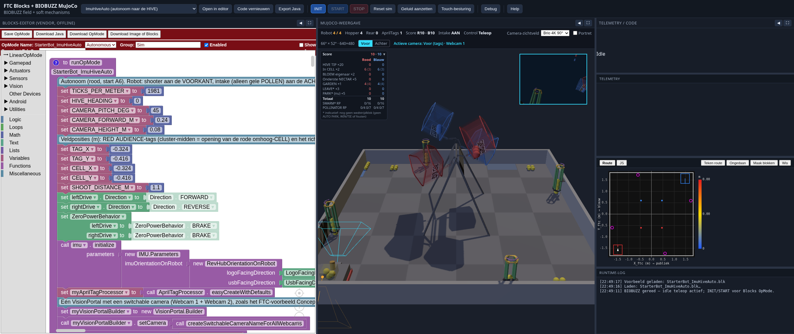

# FTC Blocks + BIOBUZZ MuJoCo

Browser app that combines **official FTC Blocks** (vendor offline editor) with the **BIOBUZZ MuJoCo WASM** field scene (hive, flowers, pollen, nectar, robot). Blocks-generated JavaScript drives the same hardware identifiers as REVStarterBot2026; on BIOBUZZ, drive actuators + soft mechanisms are mapped.

The standalone teleop viewer remains available in `../web` (port 5173).



## Quick start (combined)

```bash
cd web-blocks   # from repo root: ftc-biobuzz-mujoco/web-blocks
npm install
npm run dev
```

Open **http://localhost:5174/** (BIOBUZZ field).

### Workflow

1. Example (TankDrive / Mechanisms / EncoderAuto / **ImuAprilTag** / **ImuHiveAuto**) → *Open in editor*.
2. *Code vernieuwen* for JS/Java.
3. **INIT** → OpMode up to `waitForStart` (sim reset; OpMode owns actuators).
4. **START** / **STOP** — STOP zeros drive + mechanisms; idle teleop then becomes active again.
5. Export **Java** (optional).

### Debugger (step through your blocks)

Turn **Debug** on in the toolbar (before **INIT**). The OpMode then pauses at the first block; the current block gets a **yellow border** in the Blocks editor and the run status shows *Gepauzeerd bij blok: …*.

| Button | Behavior |
|------|---------|
| **Stap** | executes the next block and pauses again (works in INIT and after START; also in `opModeIsActive` loops). **Steps into** called procedures/functions (`procedures_callnoreturn` / `procedures_callreturn`): the function's blocks are highlighted one by one (first the `to …` definition block, then the body) |
| **Stap over** | executes the current block; if that is a function call, the **entire function runs in one go** and the debugger pauses at the next block at the same function level. **Breakpoints inside that function do still pause** (as does **Pauzeer**). On an ordinary block (not a call), Step over does the same as Step |
| **Stap uit** | runs until the current function returns and pauses at the next block in the caller (breakpoints still pause). Only active inside a function (not in `runOpMode` itself) |
| **Doorgaan** | runs until a breakpoint, **Pauzeer**, or the end |
| **Pauzeer** | pauses at the next block (also during `sleep`/`idle`/`waitForStart`) |
| **● Breakpoint** | select a statement block in the editor and click: toggle breakpoint (red dotted border); **Wis BP** clears all of them |
| **STOP** | also works during a pause (zeros motors, clears the highlight) |

**While paused, the simulation is frozen**: the OpMode is frozen and physics + sim time do not advance. Motors keep their last command (it sits in the frozen sim); telemetry stays visible. On *Stap*, no sim time elapses unless the block contains a wait (`sleep`, `idle`, `waitForStart`): then the sim runs until the wait finishes and pauses at the next block.

#### Variables

At every pause, the **Variabelen** panel shows all current variables with their values (`lok` = local to the function, `glob` = global; functions, built-in objects and the simulator APIs are not shown). Colors: **yellow** = a variable that the *previous* block just set (`variables_set`, `math_change`, for-counter) — so the value is the one **after** execution; **blue** = a variable that the *current* (not yet executed) block reads (`variables_get` in its inputs). The status line shows only the phase + block description (max. 48 characters); the `name = value` of the last set/read block is in the status line's tooltip (`title`). After **Stap**/**Doorgaan** the values turn gray (stale) until the next pause. Values are serialized safely: numbers, text (truncated at 60 characters), booleans, arrays/objects (max. 8 items, 2 levels deep, cycles → `[cyclisch]`), functions are skipped.

**Hover in the editor:** during a pause, hovering a block in the Blocks editor shows a small tooltip next to the cursor with the values of the variables in that block's *own fields* (`variables_get`, `variables_set`, `math_change`, for-counter, for-each — e.g. `totaal = 36`; multiple variables = multiple lines). Sources: the latest variables snapshot from the worker (the same as the panel) and a `mousemove` handler in the vendor iframe that looks up the block via `g[data-id]` (no Blockly bubble/warning API, no vendor patch). The tooltip disappears on Stap/Doorgaan/STOP/Debug off (only active while paused). Value blocks *inside* a block (e.g. the `totaal` in `totaal + i`) have their own tooltip; hover directly over them. Hovering a row in the **Variabelen** panel outlines (blue) all blocks that use that variable. Pure logic (block → variables → text): `src/editor/varHover.js` (`tests/unit/varHover.test.js`).

**Toolbar layout:** the status line (`#runStatus`) sits on its own row with a fixed height, `min-width:0; overflow:hidden; text-overflow:ellipsis; white-space:nowrap`; the full text is in `title`. Long text therefore never shifts buttons. The explanation hint was removed (it now lives in the `title` of the Variabelen panel). The Variabelen panel is one compact row with a fixed height that is always reserved (hidden via `visibility` when Debug is off; the debug buttons stay reserved with `visibility:hidden` and the row has a fixed `min-height`; without a pause there is a placeholder), so the layout does not jump. Button rows wrap in narrow windows.

**Depth / Step over — how it works:** the call depth (`callDepth` in `debugController.js`) is the number of *in-flight* user-function calls on the JS Interpreter `stateStack` (CallExpression states with `doneExec_` and a function with an AST body; native functions such as `highlightBlock` do not count). That comes straight from the real call stack and therefore stays correct under recursion, `return`, and errors. `runOpMode` = depth 1, a procedure inside it = 2, and so on. *Stap over* pauses at the next block with depth ≤ the current depth, *Stap uit* at depth < the current depth. The worker includes that depth with `highlightBlock` and, at every pause, sends `depth`, `prevBlockId` and `vars` to the main thread.

Implementation: Debug uses separate JS (`getDebugJavaScript()` in `blocksBridge.js`) with `highlightBlock('<id>');` before every statement block (Blockly `STATEMENT_PREFIX`, set temporarily and restored immediately). Normal Run, the JS panel and Java export stay unchanged. No vendor patch required. Logic: `public/execution/debugController.js` (tested in `tests/unit/debugController.test.js`).

The **DebugDemo** example (variables + procedure) in the example list is meant for trying Stap / Stap over / Stap uit and the Variabelen panel.

Not included (yet): custom watch expressions, editing variables during a pause, conditional breakpoints, breakpoints that survive a project reload. Breakpoints apply to the next INIT and are also pushed live during a session.

> **After worker changes** (`public/execution/*.js`, including `debugController.js`): hard-refresh with **Ctrl+Shift+R** — the browser caches Web Worker scripts aggressively. `src/execution/opModeWorker.js` must stay identical to `public/execution/opModeWorker.js` (the test checks this).

### Help

The **Help** button (right side of the toolbar) opens an in-app reference window in Dutch: panels, buttons, shortcuts, supported blocks, the debugger, and a step-by-step TankDrive example. Close it with **Esc**, ✕, or a click outside the window; the toolbar and sim are left untouched. Content lives per section in `src/help/sections/*.js` (the debugger section appears only if `#btnDebug` exists); the shortcut table is checked by `tests/unit/helpContent.test.js` against `src/main.js` and `controls.js`. If you change keys or buttons, update the Help section as well.

### UI — panels

The three panels (Blocks / Sim / Code) are **resizable** via the vertical splitters (horizontal on narrow screens). (The Blocks/Sim/Code/Equal view buttons were removed: use the splitters and ◀/⛶.) Per panel: **◀** collapse, **⛶** maximize. Widths and collapse state are stored in `localStorage` (`ftc-blocks-layout-v1`). After a layout change, the MuJoCo canvas is resized (window event + `viewer.resize()`).


### Game rules & scoring (Competition Manual TU03)

- **HIVE tip rule** (Event Field Setup Guide §12.3): the up CELL tips at **8 POLLEN** or **3 NECTAR + 3 POLLEN** (count only; more is also allowed). It holds at, among other things, 7 POLLEN, 3 NECTAR + 2 POLLEN, and 6 NECTAR with no POLLEN. Every NECTAR in the CELL counts (including released extras and the other color). At the start there are already 3 NECTAR in each up CELL, so **3 launched POLLEN tip the HIVE**. `shouldTip()` in `src/worlds/biobuzz/hive_tip.js`.
- **G407**: the robot never controls more than **4** SCORING ELEMENTS (front hopper + rear compartment combined; `ROBOT_CONTROL_LIMIT`). At 4 the intake no longer picks anything up; balls stay on the field or are pushed aside. Launched, spit, or FLOWER-placed elements no longer count. The robot starts with the **4 preload POLLEN** (G304.G) and is therefore full: shoot first. HUD: **Robot x / 4** (orange when full).
- **Score** (§10.5, Table 10-2 / 10-3), panel at the top left of the sim view and `window.__ftcSim.score()` (read-only):
  - **HIVE TIP** 20 — live, per TIP of the alliance's own HIVE.
  - **In CELL** 2, **FLOWER owner** 2 per element, **Bottom NECTAR** +5, **GARDEN** 1 — from the current field state ("if the match ended now"). Only elements that are at rest (|v| < 0.05 m/s) and not inside the robot; as long as something is still rolling, that is shown under the table. FLOWER: elements (partly) between the middle ring (≈ 10 cm: bottom ring 1.0 cm + Retrieval Opening 9.0 cm, §9.7) and the top edge (54.6 cm); owner = alliance of the top NECTAR, bonus = alliance of the bottom one. GARDEN/CELL are alliance-bound, regardless of who placed the element.
  - **With no match clock** (deliberately not built yet) the phase-dependent rules are **indicative** (marked * in the panel): **LEAVE*** (3) locks in as soon as the robot (bounding volume of all colliding geoms, including the rear intake) is ≥ 3 cm from every wall, and stays until *Reset sim*; **PARK*** (5) = "if parked now": robot is currently (partly) in its own LOADING ZONE (TELEOP PARK). **AUTO PARK**, **WIN/TIE**, and **fouls/penalties** (§10.6–10.8) are not scored. **SWARM RP*** = LEAVE + PARK ≥ 16 (with one robot max. 8, so never), **POLLINATOR RP** at ≥ 4 / ≥ 7 TIPS.
  - The robot belongs to **red**. Starting score: red 10 and blue 10 (3 NECTAR in the up CELL = 6, plus 4 POLLEN in the GARDEN = 4). No PARK or LEAVE at the start.
- **Field layout** (Event Field Setup Guide §6 Fig. 6-2, §8.3, §8.4; manual §9.3–9.5): the **LOADING ZONE** is on **TILE A5 (red) / F2 (blue)**, 23 × 11 in against the alliance wall. The **GARDEN** is on **A1 / F6**, against the audience and back wall respectively, from the corner by the ALLIANCE AREA. Extra NECTAR after a TIP enters the field in the alliance's own LOADING ZONE (G427), in a 2 × 3 grid.
  - **Orientation as on the real field** (Fig. 9-2 / Fig. 6-2): seen from the audience (−Y), the red wall is on the left (−X). Columns A→F run from −X to +X, rows 1→6 from **−Y (audience) to +Y (back)**. The red audience-side CELL (tags 34–37) and the blue scoring-side CELL (42–45) start up (Guide §11.1). The FLOWERS sit on the D/E (audience wall), B/C (back wall), 2/3 (red wall) and 4/5 (blue wall) seams. Until 2026-10 the sim was mirrored in Y, because the CAD import `(x,y,z)→(x,z,y)` was a reflection. It is now a rotation `(x,y,z)→(x,−z,y)`, see `scripts/convert_field_cad.py`. `tileCenter()` in the constants.
- **Start position (G304):** the robot stands against the red wall (−X). The rear intake touches the wall exactly, without penetration, so nothing slides away at the start. The robot is on the back stretch of the wall (A6, y +1.48 m), 8 cm outside the LOADING ZONE, with the 4 preload POLLEN in the hopper. LEAVE* only triggers once the robot is ≥ 3 cm from the wall.
  - Code: `src/worlds/biobuzz/scoring.js` (pure `computeScore()` + `BiobuzzScorer`), panel `src/ui/scorePanel.js`; tests `tests/unit/biobuzzRules*.test.js`.

### Idle teleop (BIOBUZZ, no active OpMode)

| Input | Action |
|-------|--------|
| W/S · I/K | Tank L/R |
| ↑/↓ | Tank right (same as I/K) |
| A/D or ←/→ | Arcade turn (forces arcade) |
| E / RB | Intake toggle |
| C / LB | Rear FIFO spit (hold) |
| Space/F / RT | Shoot pulse |
| X | Place FIFO → flower |
| T | Tank/arcade toggle |
| R | Reset keyframe + preload |

### OpMode keyboard → `gamepad1` overrides

| Input | Override |
|-------|----------|
| W / S | `leftStickY` −1 / +1 |
| I / K or ↑ / ↓ | `rightStickY` −1 / +1 |
| ← / → | `leftStickX` −1 / +1 |
| E | `RightBumper` |
| C | `LeftBumper` |
| X | button `X` |
| Space / F | `rightTrigger` 1 (shoot) |
| G | button `A` |
| B | button `B` |
| Y | button `Y` |
| U / J / H / L | `DpadUp` / `Down` / `Left` / `Right` |

During INIT/WAIT/RUN the **Blocks OpMode** has exclusive actuator control. Axis/button overrides are cleared on STOP/DONE/ERROR/reset.

## Drive polarity (real robot)

On the real robot the default Blocks config `leftDrive.setDirection(FORWARD)` +
`rightDrive.setDirection(REVERSE)` (as on the REV Starter Bot) drives **forward with positive power on both motors**.
The sim follows that: `simulation.json` has `leftDrive.defaultDirection = FORWARD`,
`rightDrive.defaultDirection = REVERSE` (these defaults apply when there are no setDirection blocks;
a `setDirection` block overrides them). After FTC Direction, `BiobuzzHardwareAdapter` applies
`LEFT_DRIVE_SIGN = +1` / `RIGHT_DRIVE_SIGN = -1` (`electricalToWheelSticks`) to go from
electrical motor power to logical wheel direction; encoders of the right motor
are reported in the same (mirrored) frame. Idle teleop and `web/` use
`setTankPower` with logical sticks and are **not** inverted.

## Hardware ↔ BIOBUZZ mapping

| FTC config | JS id | BIOBUZZ target |
|------------|-------|----------------|
| leftDrive | leftDriveAsDcMotor | actuator `left_drive` via `setTankPower` + `updateDriveSlew` |
| rightDrive | rightDriveAsDcMotor | actuator `right_drive` (same) |
| intakeMotor | intakeMotorAsDcMotor | `IntakeShooter.intakePower` — `>0.05` rear intake on (`intakeLayout: "rearPollen"`: yellow POLLEN only, straight to the front shooter); `<−0.05` rear spit |
| flywheel | flywheelAsDcMotor | **rising edge** `|power|>0.3` → `IntakeShooter.fire()` |
| pollenServo | pollenServoAsServo | **rising edge** `position01>0.7` → `tryPlaceNectar()` |
| crServo | crServoAsCRServo | `|power|>0.3` forces rear eject (like holding C) |
| Voltage / hub | … | stubs unchanged |
| imu | imuAsIMU | **Simulated** body yaw/pitch/roll (see `extensions.md`) |
| Webcam 1 | aprilTagAccess / colorBlobLocatorAccess / visionPortalAccess | **Simulated** AprilTags and yellow POLLEN color blobs on BIOBUZZ; no CV. Camera = **Logitech Brio 4K** (see below) |

Details: `robots/BIOBUZZ/simulation.json`. Soft devices have no MJCF joint; encoders for flywheel/intake stay at 0 (commands in telemetry/HUD).

Wheel encoders (`left_wheel_j` / `right_wheel_j`) remain available for EncoderAuto / RUN_TO_POSITION.

### Robot camera: Logitech Brio 4K

The robot camera (`robot_up_cam`) follows the real **Logitech Brio 4K**: diagonal field of view **90°** (default), **78°** or **65°** (as in Logi Tune / G HUB), native 16:9. FTC streams **640×480** (4:3) by default: a crop that preserves the vertical field of view.

| Preset (diagonal) | Vertical | Horizontal 16:9 (1280×720) | Horizontal 4:3 (640×480) |
|---|---|---|---|
| 90° (default) | 52.2° | 82.1° | 66.3° |
| 78° | 43.3° | 70.4° | 55.8° |
| 65° | 34.7° | 58.1° | 45.2° |

- **Single source:** `simulation.json` → `webcam.camera` (model, `dfovPresetsDeg`, `defaultDfovDeg`, resolution); H/V are derived in code (`src/mujoco/robotCamera.js`, unit-tested). The same values drive the PiP camera image (Three.js `robotCam`), the frustum pyramid, AprilTag detection and POLLEN color-blob detection (`computePollenColorBlobs`: same H × V, image size = stream resolution, including for unity ROIs).
- **"Camera-zichtveld" dropdown** in the sim HUD; the choice is stored in `localStorage` (`ftc-sim-camera-dfov-v1`). Switching takes effect immediately.
- **Visibility = rectangular frustum:** |horizontal angle| ≤ H/2 and |vertical angle| ≤ V/2 in the camera frame (no longer a cone), plus a 2.5 m range and a facing threshold.
- **`setCameraResolution`** (VisionPortal.Builder) sends the resolution to the sim; 1280×720 therefore gives 16:9 with the full horizontal field of view. It returns to 640×480 on the next INIT or *Reset sim*.
- MJCF `fovy` of `robot_up_cam` = 52.2 (vertical at 90°); for another preset, `model.cam_fovy` is updated. The PiP image comes from the Three.js camera, not from the MuJoCo renderer.
- **Landscape (default, `pitchDeg` 35 at the front) or portrait:** `webcam.camera.orientation` = `"landscape"` or `"portrait"` (camera rotated 90° about the lens); the **Portret** checkbox next to the dropdown switches immediately (stored in `localStorage`, `ftc-sim-camera-orientation-v2`). Upright, the image is then 52.2° × 66.3° (480×640; at 1280×720: 52.2° × 82.1°). `cameraFov()` returns the sensor frame (`hfovDeg`/`vfovDeg`/`width`/`height`, unchanged) and the upright image (`viewHfovDeg`/`viewVfovDeg`/`viewAspect`/`viewWidth`/`viewHeight`, swapped).
  - The roll is in the mount (`mountQuat(pitch, roll)`), so site/camera `robot_up_cam` rotate with it: the frustum pyramid and AprilTag/POLLEN detection work in the **sensor frame** (640×480, image-X = long side, pointing up). That is also how the FTC SDK presents it (VisionPortal does not un-rotate a rotated webcam): blob-X = world-vertical (small = bottom), blob-Y = world-horizontal (small = left), ROIs in that same frame, `ftcPose` x/z rotated.
  - The PiP image undoes the roll and is therefore upright and tall-narrow (3:4 / 9:16).
- **Camera position:** `webcam.camera.mount` = `{ x, y, z, pitchDeg, rollDeg }` in the robot frame (z from the robot origin; lens above the mat ≈ z + 0.044 m; `rollDeg` 90 = portrait, −90 = the other way; without `rollDeg` it follows from `orientation`). Applied to site + camera `robot_up_cam` at load (`applyCameraMount`), so PiP, frustum, AprilTag and POLLEN detection follow. Missing fields = default mount.
- **Default: portrait, lens 16.5 cm above the mat, +17.5°, 90°, 640×480** → `mount: { "x": 0.24, "y": 0, "z": 0.121, "pitchDeg": 17.5, "rollDeg": 90 }` (in front of the intake; adjusted vs. #22 so nearby POLLEN do not fall below the frame). Geometry study on the real scene (5 cm grid × 72 directions, tag seen = in the frustum, ≤ 2.5 m, facing ≥ 0.55; floor = POLLEN center in frustum; occlusion ignored):

  | Mount | Bottom edge | Floor from | Tag 1.25 m from | Field positions | Poses | Distance to tags (p5–p95) | Shooting zone covered |
  |---|---|---|---|---|---|---|---|
  | **portrait 16.5 cm, +17.5° (default)** | −15.7° | 0.46 m | 0.88 m | **61 %** | 8.9 % | ~0.88–1.6 m | **95 %** |
  | portrait 18.5 cm, +22.5° (PR #22) | −10.7° | 0.79 m | 0.72 m | 72 % | 11.4 % | 0.76–1.62 m | 96 % |
  | landscape, 18.5 cm / +22.5° | −3.6° | 2.36 m | 0.93 m | 0 % | 0 % | — | 0 % |
  | landscape low 6.5 cm, +22.5° (`z: 0.021`) | −3.6° | 0.47 m | 1.04 m | 55 % | 9.6 % | 1.07–1.77 m | 93 % |
  | old: landscape 32.4 cm, +39.7° (MJCF pose) | +13.6° | never | 0.41 m | 0 % | 0 % | — | 0 % |

  "Shooting zone" is an **assumption**: the positions from which the sim shooter (5.7 m/s, 75°) can get a POLLEN into an up CELL (MuJoCo shots on a 10 cm grid; distance to the CELL opening ±1.06–1.54 m); coverage = robot aims at the CELL and sees the floor + ≥ 1 tag of that CELL. There is no shooting zone defined in the repo or the game rules here. Portrait makes a higher, practical mount possible: at 18–35 cm, portrait 480×640 still reaches ±62–75 % of positions, landscape only 21–44 %. With 1280×720 portrait (+32.5°) ±95 %. The MJCF pose of `robot_up_cam` is unchanged (old pose, `LEGACY_CAMERA_MOUNT`); the default comes from `simulation.json` / `DEFAULT_CAMERA_MOUNT`.
- Not modeled: lens distortion, autofocus/zoom (Brio digital zoom/RightLight), exact sensor crop per resolution.


## GitHub Pages

Production build is deployed from this folder to:

**https://koenvanwijk.github.io/ftc-biobuzz-mujoco/**

Workflow: `.github/workflows/deploy-pages.yml` (`VITE_BASE=/ftc-biobuzz-mujoco/`).

Local production-base preview:

```bash
VITE_BASE=/ftc-biobuzz-mujoco/ npm run build
npx vite preview --host 0.0.0.0 --port 5174
# open http://localhost:5174/ftc-biobuzz-mujoco/
```

## Scripts

| Script | Meaning |
|--------|-----------|
| `npm run dev` | Vite on **5174** |
| `npm run build` | Production build |
| `npm test` | Unit/integration tests |
| `npm run smoke` | Artifacts + tests + BIOBUZZ WASM smoke |

## Documentation

- `INTEGRATION.md` — physics owner, teleop vs OpMode, STOP
- `ARCHITECTURE.md` — threads, clock, worker
- `SUPPORT_MATRIX.md` — working / partial / unsupported (+ soft mechanisms)
- `robots/BIOBUZZ/` · `robots/REVStarterBot2026/`

## Assets

BIOBUZZ XML/meshes/textures are **copied** into `public/assets/` (source: `ftc-biobuzz-mujoco/web/public/assets`). World code lives in `src/worlds/biobuzz/` (a copy, no cross-project import).

## Important assumptions

- Physics has not been validated against a real robot.
- BIOBUZZ intake/shoot/place are **soft bridges**, not pure joint actuators.
- IMU + Webcam/AprilTag/ColorBlobLocator are **explicit simulator extensions** (toolbox + runtime); not silent placeholders — details in `src/config/extensions.md`.

## Robot sound

Click **Geluid aanzetten** for browser autoplay permission; clicking again mutes everything.
The flywheel, intake and drive recordings run independently, only while their motor commands are active
(including reverse and `setVelocity`; `RUN_TO_POSITION` stops at the target). In idle teleop the
flywheel plays for as long as Space/F or RT is held. The intake is on by default in idle teleop.
STOP/DONE/ERROR stop the OpMode sounds immediately; after that, sound follows the resumed idle teleop.
Pause and a hidden tab are silent. Collision sound follows new robot contacts with the field or
elements, not ground/wheels, self-contact, spawn contact, or continuously pushing against a wall.
A contact gap of at least 0.12 s re-arms an impact (global cooldown 0.15 s).

The four original recordings belong in `public/audio/{flywheel,intake,drive,collision}.m4a`.
There is no synthesized fallback sound. Missing or unsupported recordings show
a message in the log and the **Geluid opnieuw proberen** button; the simulation keeps running.
